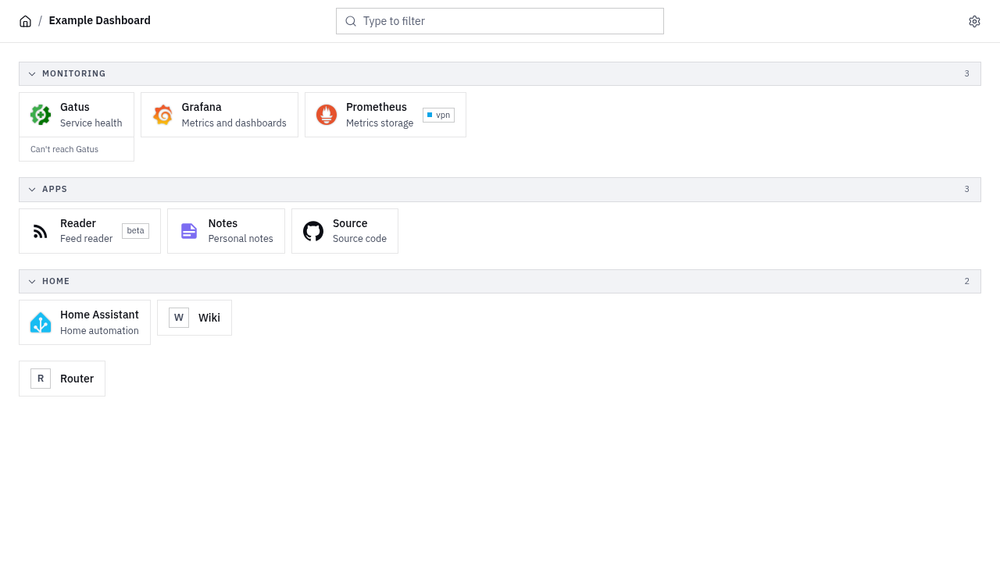

<picture>
  <source media="(prefers-color-scheme: dark)" srcset="docs/logo-dark.svg">
  
</picture>

# pin

A self-hosted bookmark dashboard driven by one YAML file. No database, no accounts, no in-app editing.

<picture>
  <source media="(prefers-color-scheme: dark)" srcset="docs/screenshot-dark.png">
  
</picture>

- Links in flat groups, with labels and icons from popular icon sets.
- Live status on a link's tile (Gatus).
- Type anywhere to filter. Enter opens the top match.
- Light and dark themes. Desktop and phone. Installable as an app.
- One static binary with the web app embedded, or a Docker image.

## Quick start

Create `pin.yaml`:

```yaml
title: Home
bookmarks:
  - name: Grafana
    url: https://grafana.example.com
    group: Monitoring
    icon: grafana
```

Run it with Docker:

```sh
docker run -d --name pin -p 8080:8080 \
  -v "$PWD/pin.yaml:/config/pin.yaml:ro" \
  ghcr.io/flexdinesh/pin:latest
```

Or with the binary from [Releases](https://github.com/flexdinesh/pin/releases):

```sh
./pin serve    # reads ./pin.yaml, listens on :8080
```

Open http://localhost:8080.

For a fuller example, see [`pin.example.yaml`](pin.example.yaml).

## Docs

- [Configuration](docs/configuration.md): YAML reference, icons, labels, env vars and flags.
- [Deployment](docs/deployment.md): Docker, Compose, binary with systemd, Kubernetes, reverse proxy, unix socket, subpath.
- [Widgets](docs/widgets.md): live status on tiles.
- [Usage](docs/usage.md): keyboard, settings, installing the app.

## Security

pin has no authentication. Anyone who can reach it can read every link. Keep it on a trusted network or put it behind a proxy that authenticates. See [SECURITY.md](SECURITY.md).

## Contributing

See [CONTRIBUTING.md](CONTRIBUTING.md).

## License

[MIT](LICENSE)
