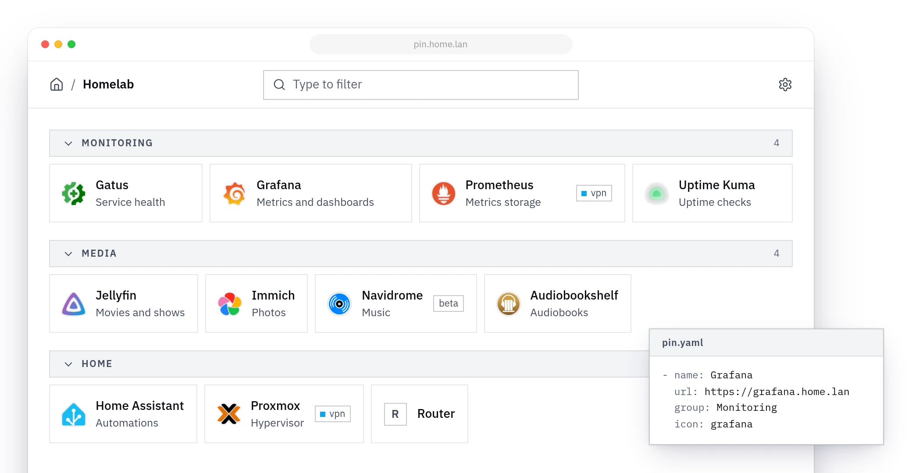

<picture>
  <source media="(prefers-color-scheme: dark)" srcset="docs/logo-dark.svg">
  
</picture>

# pin

**Your homelab's start page, from one YAML file.**

[](https://github.com/flexdinesh/pin/actions/workflows/ci.yml)
[](https://github.com/flexdinesh/pin/releases)
[](LICENSE)

<picture>
  <source media="(prefers-color-scheme: dark)" srcset="docs/cover-dark.webp">
  
</picture>

pin is a fast, self-hosted bookmark dashboard. List your links in `pin.yaml`, keep it in Git, restart pin, done. No database, no accounts, no settings page to click through. Open it, type a few letters, press Enter, and you're there.

## Features

- **Reach, don't browse.** Type anywhere to filter by name, description, label or group. Enter opens the top match, Tab walks the results, Esc clears.
- **One file, checked.** Unknown keys, bad URLs and unquoted colors stop startup, and pin lists every problem at once.
- **Live status on the link.** Gatus up and down counts sit on the tile. pin fetches them server-side, so there's no CORS setup and internal addresses never reach the browser.
- **Icons that just work.** Dashboard Icons, selfh.st, Material Design, Simple Icons or any URL. If an icon fails, a monogram stands in.
- **Groups and labels.** Flat groups in config order, collapsible per browser. Colored labels show as small tags.
- **Desktop and phone, equally.** Content-sized tiles on desktop, two lanes on phones, light and dark themes. Installable as an app, with pull to reload.
- **Yours, per browser.** Theme, columns, density, link target and descriptions are saved locally. The server knows nothing about viewers.
- **Ships small.** One static binary with the web app embedded, for Linux, macOS and Windows on amd64 and arm64, or a Docker image. Unix socket, subpath and healthcheck built in.

## Quick start

Create `pin.yaml`:

```yaml
title: Home
bookmarks:
  - name: Grafana
    url: https://grafana.example.com
    group: Monitoring
    icon: grafana
```

Run it with Docker:

```sh
docker run -d --name pin -p 8080:8080 \
  -v "$PWD/pin.yaml:/config/pin.yaml:ro" \
  ghcr.io/flexdinesh/pin:latest
```

Or with the binary from [Releases](https://github.com/flexdinesh/pin/releases):

```sh
./pin serve    # reads ./pin.yaml, listens on :8080
```

Open http://localhost:8080.

For a fuller example, see [`pin.example.yaml`](pin.example.yaml).

## Docs

- [Configuration](docs/configuration.md): YAML reference, icons, labels, env vars and flags.
- [Deployment](docs/deployment.md): Docker, Compose, binary with systemd, Kubernetes, reverse proxy, unix socket, subpath.
- [Widgets](docs/widgets.md): live status on tiles.
- [Usage](docs/usage.md): keyboard, settings, installing the app.

## Security

pin has no authentication. Anyone who can reach it can read every link. Keep it on a trusted network or put it behind a proxy that authenticates. See [SECURITY.md](SECURITY.md).

## Contributing

See [CONTRIBUTING.md](CONTRIBUTING.md).

## License

[MIT](LICENSE)
